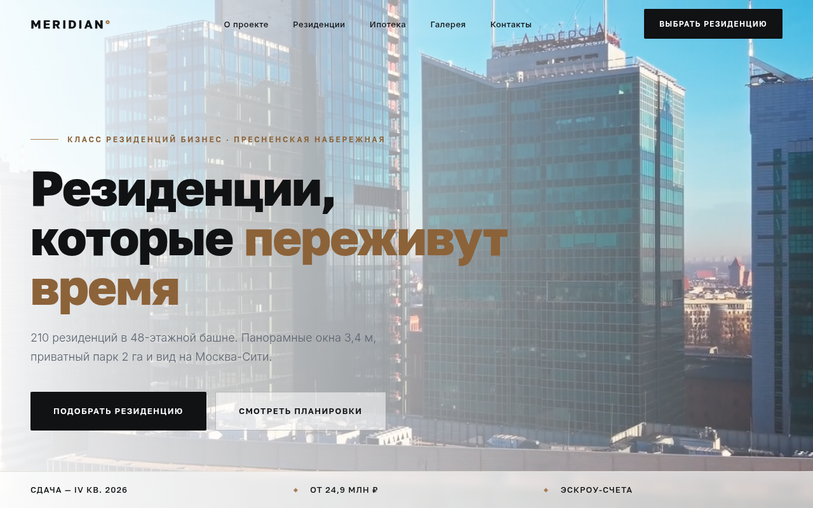
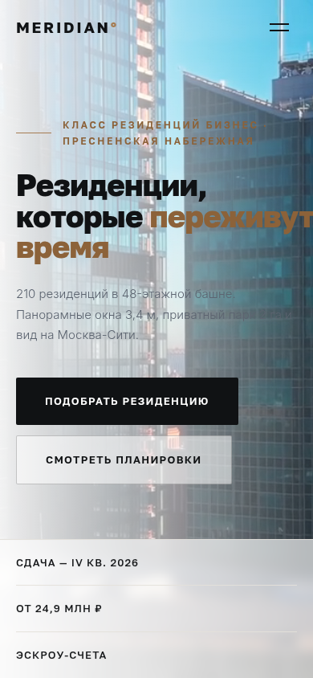

# MERIDIAN° — концепт-сайт резиденций бизнес-класса

## Демо

**[Открыть сайт →](https://shalim-andrej.github.io/meridian/)**




Премиальный одностраничник вымышленного девелоперского проекта MERIDIAN°: резиденции бизнес-класса у Москва-Сити. Кейс о том, как сайт недвижимости зарабатывает лиды — целевое действие здесь не «купить», а заявка на PDF-презентацию.

**Демо:** [shalim-andrej.github.io/meridian](https://shalim-andrej.github.io/meridian/)

## Визуальный язык

- Бронзово-графитовая палитра, архитектурная строгость
- Максимально разреженный трекинг заголовков — «чертёжный» ритм
- Видео-обложка в первом экране
- Крупные видовые кадры и панорамы

Каждый проект в премиум-пятёрке имеет собственную сетку и палитру — MERIDIAN° отвечает в связке за «архитектуру и статус».

## Структура страницы

| Блок | Содержание |
|---|---|
| Первый экран | видео-обложка, позиционирование проекта |
| О проекте | концепция и расположение |
| Резиденции | планировки и типы |
| Ипотека | условия и партнёры — снятие возражения по деньгам |
| Галерея | рендеры и виды |
| Контакты | телефон, офис продаж |
| Заявка | форма на PDF-презентацию: имя, телефон, тип резиденции |

## Что внутри технически

- **HTML5-видео** в hero-секции
- **Glassmorphism** — панели и карточки на `backdrop-filter`
- **Параллакс** — слои, привязанные к скроллу
- **Reveal-анимации** на IntersectionObserver + кастомные `@keyframes`
- **CSS Grid** и кастомные свойства, fluid-типографика на `clamp()`
- **Адаптив** всех блоков, `loading="lazy"` для изображений
- **Open Graph** разметка и `meta description`
- **Ноль зависимостей** — vanilla JS, стили и скрипты написаны с нуля

## Запуск локально

```bash
git clone https://github.com/shalim-andrej/meridian.git
cd meridian
```

Откройте `index.html` в браузере — сборка и зависимости не нужны.

## Автор

Разработчик — Андрей Шалимов ([@shalim-andrej](https://github.com/shalim-andrej)).
Заказать сайт: [Kwork](ССЫЛКА_НА_ПРОФИЛЬ_KWORK)

> Проект демонстрационный: бренд вымышленный, сайт создан как портфолио-кейс.